# EVE Spectrum Correction

This project focuses on verifying and extending the results from **“基于 SDO/EVE 光谱观测对太阳大气等离子体运动的研究”** (Cheng et al., 2021).  
The primary goals are

* to calibrate EVE spectral data (with special attention to the cruciform-scan optics),
* to analyse long-term spectral behaviour,
* and to explore how AIA images can be mapped to EVE spectral parameters.

---

## Project Structure

| Chapter / Folder      | Objective                                                    | Key Files                                                    |
| --------------------- | ------------------------------------------------------------ | ------------------------------------------------------------ |
| **Chapter 3**         | Cruciform-scan calibration; verify solar-plasma-motion study | `AIA_main/`, `data_frame.pkl`, `Func_Performance_Analysis.ipynb`, `结构.xmind` |
| **Chapter 4 v1**      | First full-pipeline test of EVE L2 processing                | `combine_basic.ipynb`, `constant.py`                         |
| **Chapter 4 v2**      | Refined mapping of AIA ➔ EVE (He II 304 Å)                   | `basic_ops/`                                                 |
| **Chapter 4 v3**      | Four-year temporal scan of 46 EVE lines                      | `basic_ops/`, `新建文件夹/`                                  |
| **Period_EVE_v1**     | Global periodicity search with wavelets                      | `daily_plot.ipynb`, `do_wavelet.py`                          |
| **Flare Spectrum v1** | Response of EVE lines to solar flares                        | `FirstGlance_Flare.ipynb`, `data/`                           |
| **SolarWind v1**      | 1000-day cross-calibration of AIA & EVE                      | `combine_basic.ipynb`, `error_function.py`                   |

---

## Chapter 3  — Cruciform-Scan Calibration

### 3.1  Input Data for the Cruciform Scan  

The Chamberlin (2016) relation is adopted as the sole external input:

$$
\Delta\lambda = 19.8\sin^{2}\phi \;+\; 4.3\sin\theta
$$

---

### 3.2  Central-Wavelength Shift versus Incident Angles (α, β)

| Simulation (this work, 2048² resolution)                     | From Cheng et al. (2021)                                     |
| ------------------------------------------------------------ | ------------------------------------------------------------ |
| 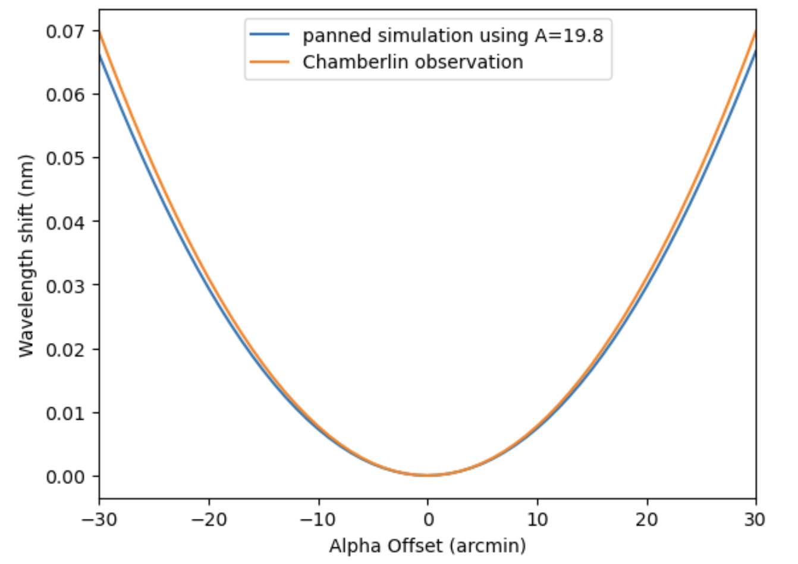 | 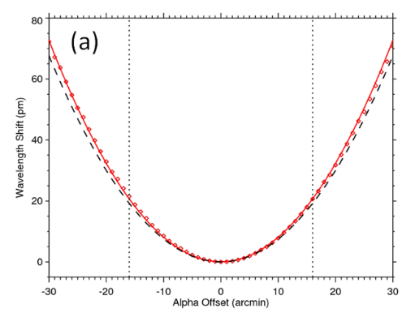 |

*My correction (blue) yields a positive-going shift, whereas the paper’s correction yields a negative-going shift.*

---

### 3.3  Why Does the β-Scan Curve Flatten?

Solar irradiance was nearly constant during the scan, implying occultation by the entrance slit.  
Yet the sudden dip in panel (c) below remains unexplained:

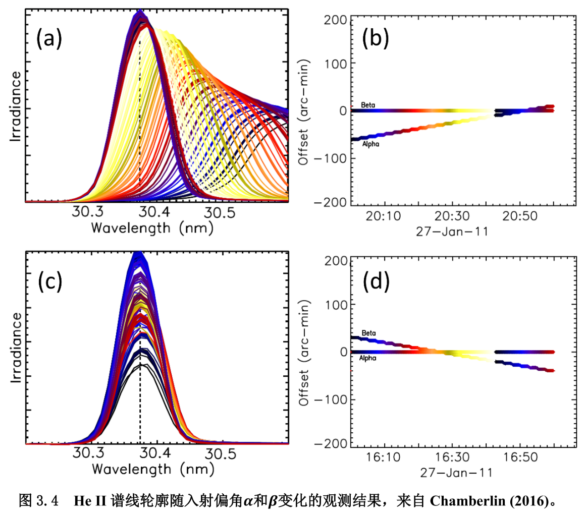

Because the detailed slit geometry is unavailable, we diverted to long-term Doppler analysis:

| STEREO-A field brightness                                    | STEREO-B field brightness                                    |
| ------------------------------------------------------------ | ------------------------------------------------------------ |
| 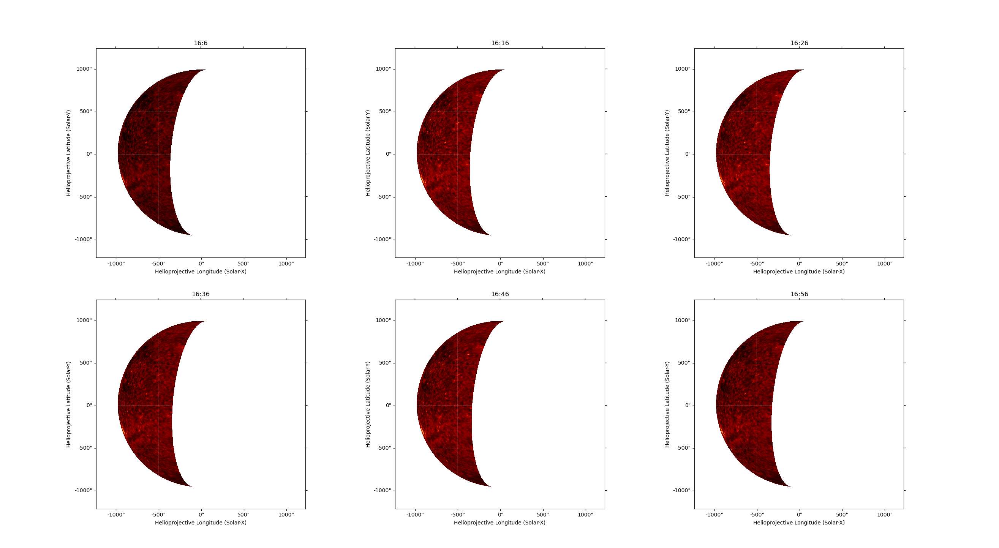 | 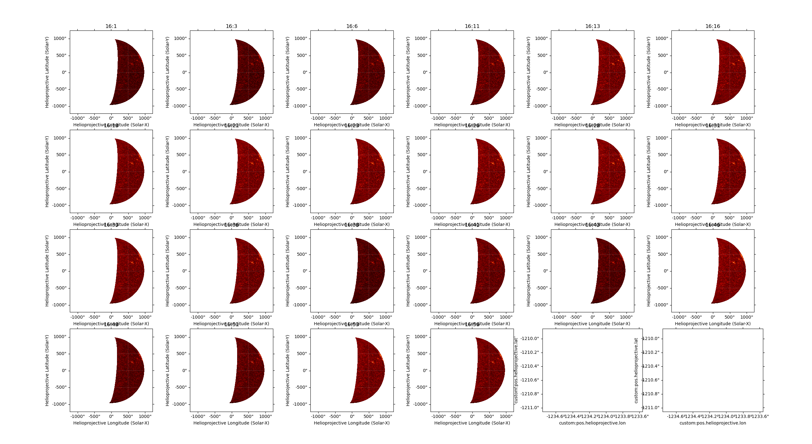 |

No appreciable change was found in the EUVI 30.4 nm band throughout the β-scan:

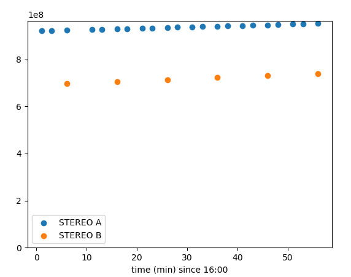

---

## Chapter 4  — EVE Spectral Analysis

### 4.1  Expected Optical-Correction Trend

Corrected line-centre should be flat (dashed reference):

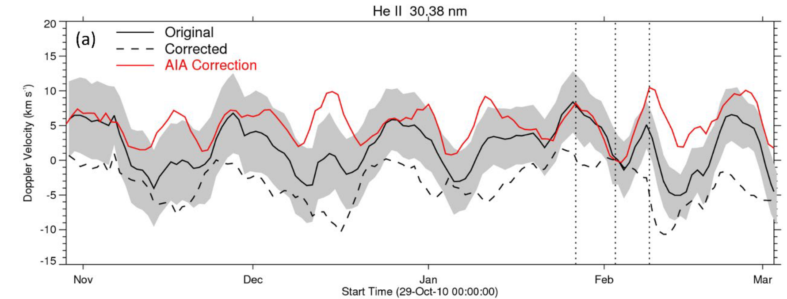

---

### 4.2  Overview of EVE L2 Data

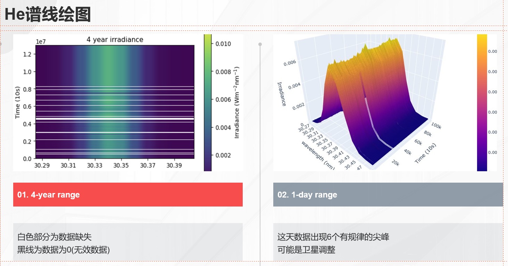

Daily statistics (8640 points day⁻¹) with ±3 σ shading:

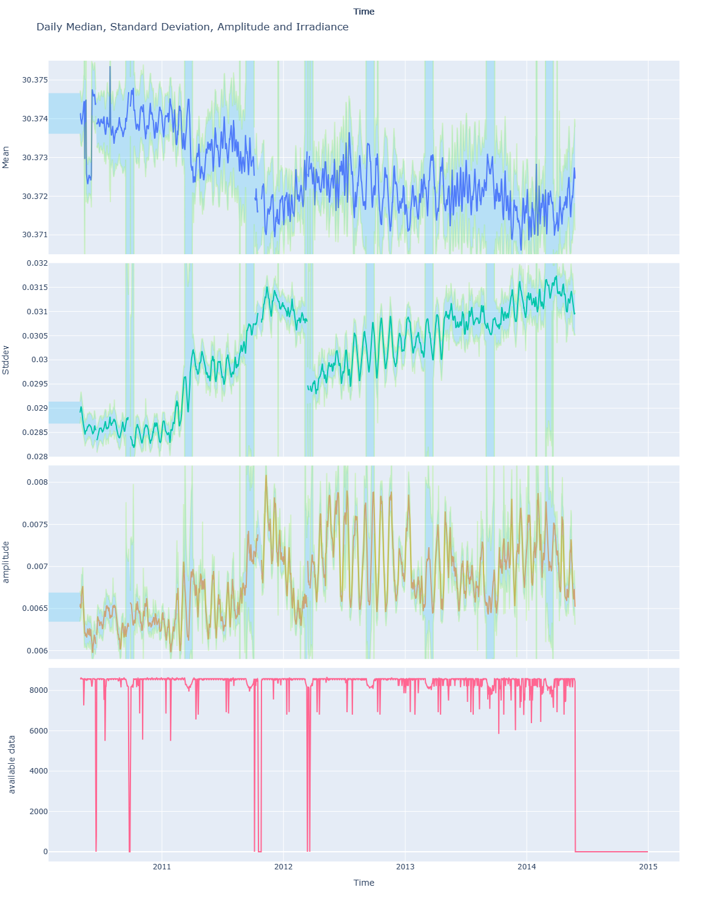

---

### 4.3  AIA Simulation vs. EVE Observation

| Constant FWHM assumption                                     | Variable FWHM                                           |
| ------------------------------------------------------------ | ------------------------------------------------------- |
| -1686219585220-3.png) | .png) |

---

### 4.4  Long-Term Monitoring of He II 304 Å

*Amplitude, centre, and FWHM have been tracked continuously since 2010-05-01.*

Wavelet transform of the line-centre parameter:

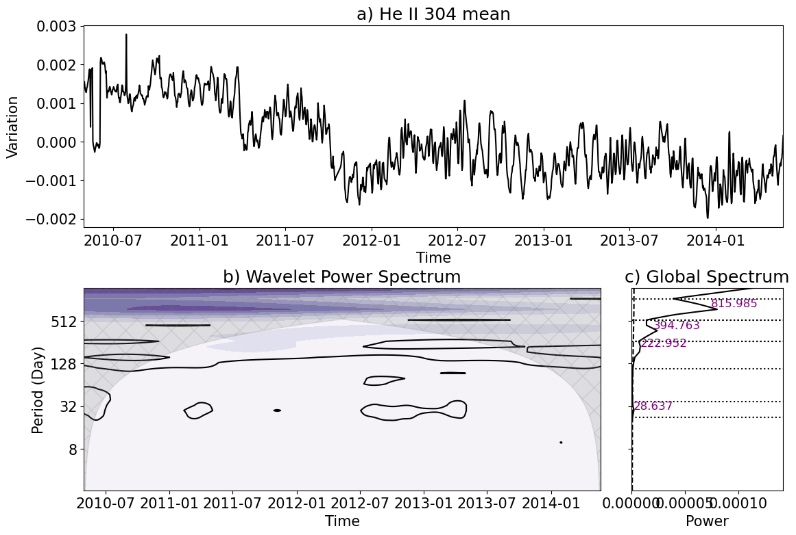

Peak periods across 46 lines versus formation temperature:

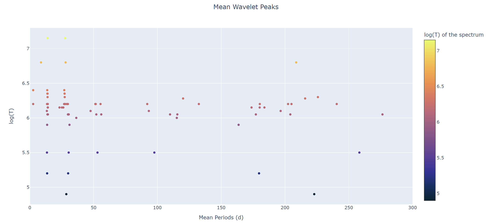

No single global periodicity emerges, although individual lines show strong 27-day and 13-day signatures.

---

## Chapter 5  Solar Flares

During several M- and X-class flares the He II 304 Å FWHM narrows, while amplitude spikes and line centre blueshifts by ≈ 20 km s⁻¹.  
Data for 50+ flares have been collected for statistical study (see *Flare Spectrum v1*).

---

## Chapter 6  Cross-Calibration with Solar Wind

A 1000-day pixel-wise correction scheme links AIA EUV images to synthetic EVE spectra.  
Gaussian models for 12 strong lines are fitted, but full propagation of AIA errors is pending.

---

## Summary

This repository delivers

1. **A reproducible cruciform-scan calibration** that exposes a sign error in the published correction curve.  
2. **A four-year archive of EVE He II 304 Å diagnostics** with daily wavelet analysis, revealing persistent rotational periodicities but no multi-line global mode.  
3. **Preliminary flare and solar-wind cross-calibrations** laying the groundwork for future automated prediction of EVE spectra from AIA images.

Further work will refine the pixel-by-pixel AIA➔EVE mapping, incorporate slit-diffraction modelling, and extend the flare database to Solar Cycle 25.

---
